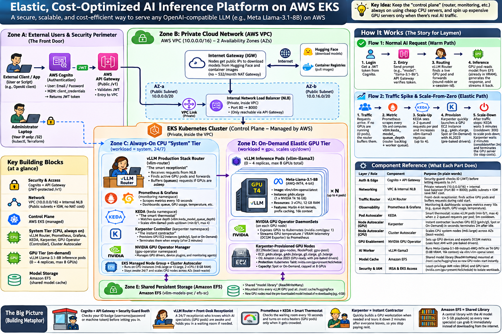

# Elastic Cost-Optimized AI Inference Platform

## Architecture Overview

<p align="center">
  
</p>

This platform provides a secure, OpenAI-compatible LLM inference gateway (using `Meta-Llama-3.1-8B-Instruct-AWQ-INT4` as an example) on **AWS EKS**, designed around a single core principle: **keep the control and routing plane always on using lightweight CPU nodes, and spin up expensive GPU compute only when real inference traffic arrives.**

### Key Architectural Zones

* **Zone A — External Users & Security Perimeter:** Clients and backend scripts authenticate with **AWS Cognito** (supporting both user credentials and OAuth2 `client_credentials` M2M tokens) to obtain a JWT before calling the public **AWS API Gateway** (`/v1`). Administrative access (`kubectl` and Terraform) to the EKS API server is restricted strictly to your single dynamic public IP (`/32`).
* **Zone B — Private Cloud Network (AWS VPC):** A `10.0.0.0/16` VPC spanning two Availability Zones with public subnets and an **Internet Gateway (IGW)**—allowing nodes to pull container images and Hugging Face weights directly without incurring ~$32/month NAT Gateway fees. API Gateway connects privately via a **VPC Link** to an **Internal Network Load Balancer (NLB)** (`Port 80 -> 8000`) so external traffic cannot bypass Cognito.
* **Zone C — Always-On CPU "System" Tier (`workload=system`):** Runs 24/7 on cost-effective CPU instances (`m6i.large` / `t3.large`) managed by an EKS Managed Node Group and **Cluster Autoscaler**:
  * **vLLM Production Stack Router (`vllm-router`):** Discovers live worker pod IPs in real time, routes requests (round-robin or `x-session-id` sticky sessions), and buffers incoming requests during scale-from-zero cold starts.
  * **Prometheus & Grafana:** Scrapes router, worker, and NVIDIA DCGM GPU metrics every 10 seconds and computes a unified `vllm:keda_model_queue_depth` recording rule.
  * **KEDA & Karpenter:** KEDA scales the vLLM Deployment based on queue depth (`threshold: 2` requests/pod, 5-minute cooldown), while Karpenter dynamically provisions Spot/On-Demand `g4dn`/`g5` GPU nodes in seconds and terminates them 2 minutes after becoming empty.
  * **NVIDIA GPU Operator:** Exposes `nvidia.com/gpu` resources and telemetry while skipping redundant driver/toolkit compilation by leveraging pre-baked AL2023 GPU AMIs.
* **Zone D — On-Demand Elastic GPU Tier (`workload=gpu`):** Tainted (`nvidia.com/gpu=present:NoSchedule`) to isolate expensive GPU hardware strictly for `vllm-llama3` worker pods (`g4dn.xlarge`, 1x NVIDIA T4 16GB VRAM, 0–4 replicas, capped at 8 total GPUs).
* **Zone E — Shared Persistent Storage (Amazon EFS):** A `ReadWriteMany` EFS volume (`vllm-models-pvc`) mounted at `/root/.cache/huggingface` across all GPU pods so newly provisioned nodes load cached model weights immediately rather than re-downloading ~5 GB from Hugging Face on every scale-up event.

---

## Prerequisites

Ensure the following CLI tools are installed before starting:

| Tool | Purpose | Verification Command |
| :--- | :--- | :--- |
| **AWS CLI (v2)** | Interact with AWS services & EKS | `aws --version` |
| **Terraform (>= 1.5)** | Provision cloud infrastructure | `terraform -version` |
| **kubectl** | Manage Kubernetes deployments | `kubectl version --client` |
| **jq** & **curl** | Parse JSON tokens & test APIs | `jq --version` |
| **Python 3.9+** *(Optional)* | Run the OpenAI SDK example | `python3 --version` |

---

## Quickstart (Command-Line)

### 1. Configure Credentials
Copy the environment template and fill in your personal AWS keys, Hugging Face token, and desired passwords:

```bash
cp .env.example .env
# Open .env in your editor and replace all <YOUR_...> placeholders
set -a && source .env && set +a
```

> **Security Note:** Never commit your `.env` file to version control. Ensure `.env` is listed in your `.gitignore`.

### 2. Provision Infrastructure & Deploy LLM
Run the automated deployment script to create the EKS cluster, configure `kubectl`, and deploy the Llama-3.1 model:

```bash
chmod +x scripts/*.sh
./scripts/deploy.sh
```

Wait until the vLLM pod status reaches `Running` (this may take several minutes while Karpenter provisions GPU nodes and downloads model weights):

```bash
kubectl get pods -l app=vllm-llama3 -w
```

### 3. Authenticate & Generate an API Token
This gateway uses Amazon Cognito to issue short-lived JWT tokens in place of static OpenAI API keys. Load your `OPENAI_API_BASE` and `OPENAI_API_KEY` automatically into your shell:

```bash
# Option A: Authenticate as an End User (Default)
eval "$(./scripts/get_token.sh user)"

# Option B: Authenticate via Machine-to-Machine (M2M) OAuth2
eval "$(./scripts/get_token.sh m2m)"
```

### 4. Test the Endpoint

**List available models:**
```bash
curl -s "${OPENAI_API_BASE}/models" \
  -H "Authorization: Bearer ${OPENAI_API_KEY}" | jq .
```

**Send a chat completion request:**
```bash
curl -s -X POST "${OPENAI_API_BASE}/chat/completions" \
  -H "Authorization: Bearer ${OPENAI_API_KEY}" \
  -H "Content-Type: application/json" \
  -H "x-session-id: llama-test-01" \
  -d '{
    "model": "llama-3.1-8b",
    "messages": [
      {"role": "system", "content": "You are a concise cloud architecture assistant."},
      {"role": "user", "content": "Explain how paged KV caching reduces GPU memory fragmentation in vLLM."}
    ],
    "temperature": 0.2,
    "max_tokens": 200
  }' | jq .
```

**Run the Python OpenAI SDK streaming test:**
```bash
pip install openai boto3
python3 scripts/test_inference.py
```

**Verify NVidia GPU Stats:**
```bash
./scripts/verify_gpu.sh
```

### 5. Cleanup

**Cleanup the entire EKS Cluster with vLLM Router (and any deployed LLMs) plus other external dependencies:**
```bash
./scripts/destroy.sh
```

---

## Troubleshooting

* **Check GPU Node Provisioning (Karpenter):** If pods stay in `Pending` state, inspect Karpenter logs:
  ```bash
  kubectl logs -n karpenter -l app.kubernetes.io/name=karpenter --tail=100
  ```
* **Check Router Pods:**
  ```bash
  kubectl get pods,rs -l app=vllm-router -n default
  ```
* **Fix Terraform State Drift on `vllm_router`:** If Terraform fails to reconcile the router deployment:
  ```bash
  cd terraform
  terraform state rm kubernetes_deployment_v1.vllm_router
  terraform import kubernetes_deployment_v1.vllm_router default/vllm-router
  terraform apply
  ```